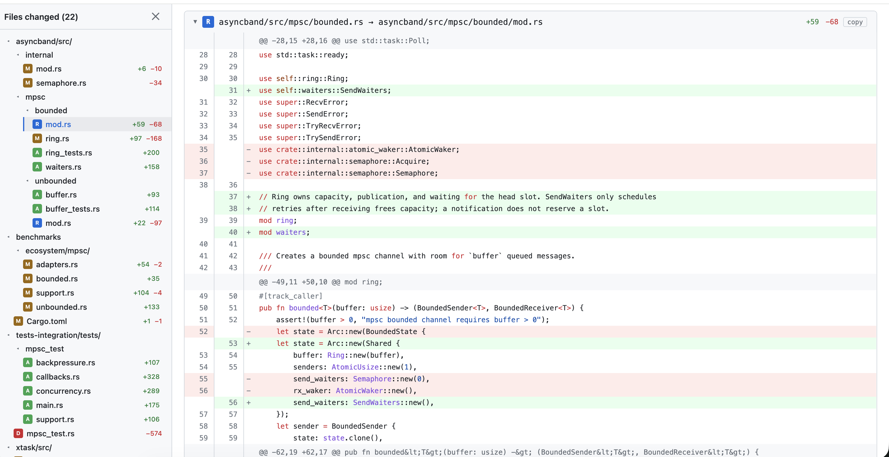
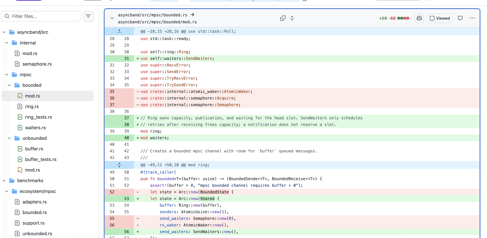

# diff2html

Generate GitHub-style HTML diff views from git diff output or commit hashes. Each file's diff is shown as a collapsible section with syntax highlighting, making it easy to navigate large changes.

Example:



What GitHub shows:



## Usage

```bash
# Diff current branch against its gh stack parent, or main/master when not
# stacked; changes staged in the index are included (unstaged edits are not)
python diff2html.py

# Diff current branch against a specific branch (plus staged changes)
python diff2html.py -b main

# Specify a commit (compare commit..index, so staged changes are included)
python diff2html.py abc123def

# From a diff file
python diff2html.py diff.patch

# From stdin
git diff HEAD~3 HEAD | python diff2html.py --stdin

# Custom output file
python diff2html.py -o review.html
```

### Options

| Argument | Description |
|----------|-------------|
| `source` | Commit hash, diff file path, or omit to diff current branch against its gh stack parent or main/master |
| `-b, --branch` | Compare current branch against the given branch, including staged changes (e.g. `-b main`) |
| `-o, --output` | Output HTML file (default: `diff.html`) |
| `--stdin` | Read diff from stdin |

## Features

- **File-based view** — each changed file is a collapsible `<details>` panel with a copy-path button
- **Stats summary** — `N files changed | +X additions | -Y deletions` above the stacked file diffs, with expand/collapse all
- **Sidebar tree** — expanded by default; directory tree with file status and stats for quick navigation, stacked diffs follow the same order
- **Expand / collapse all** — toggle all files at once
- **Syntax highlighting** — source code in diffs is highlighted via `pygments` (auto-detected from file extension), with GitHub-style token colors
- **Line wrapping** — long lines wrap inside the row like GitHub (line number stays on the first visual line) instead of scrolling horizontally
- **GitHub-style light theme** — inline CSS, no external dependencies
- **Commit metadata** — shows title, author, date when diffing against a branch or commit
- **gh stack support** — automatically compares a stacked branch with the layer immediately below it; explicit `-b/--branch` takes precedence
- **Staged changes included** — diffs compare the base ref with the index, so `git add`-ed changes are part of the view (unstaged working-tree edits are not)
- **No external runtime dependencies** — pure Python standard library; `pygments` is optional but recommended
- **WSL support** — auto-detects WSL2 and prints a `file://wsl$/...` URL for Windows browser

## Requirements

- Python 3.10+
- `pygments` (optional, for syntax highlighting) — `pip install pygments`. Without it the diff
  still renders, but the page is plain text and a warning is printed. Homebrew's Python is marked
  externally managed, so there it takes `python3 -m pip install --break-system-packages pygments`,
  and the package has to be reinstalled after every `brew upgrade python`.
